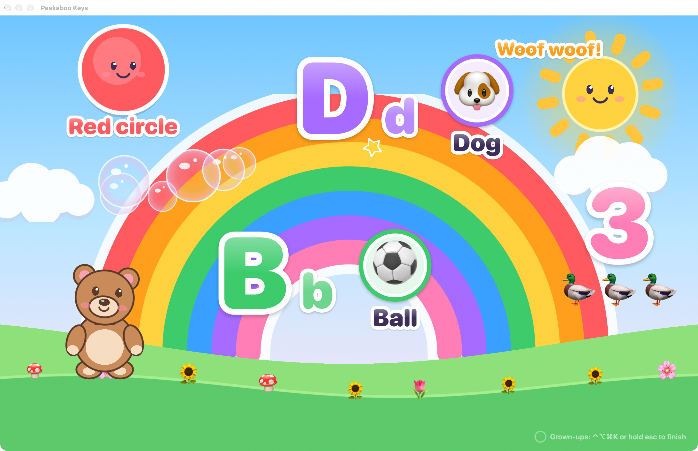
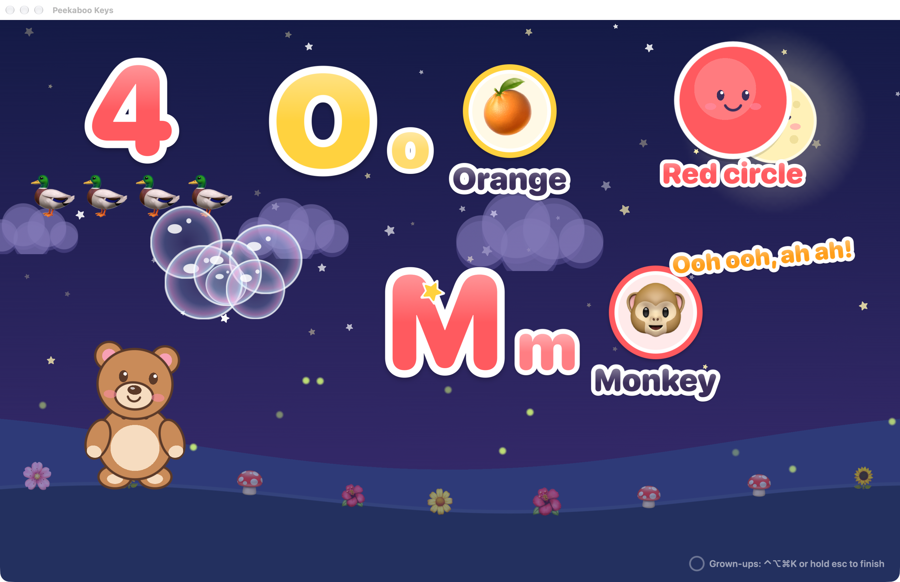
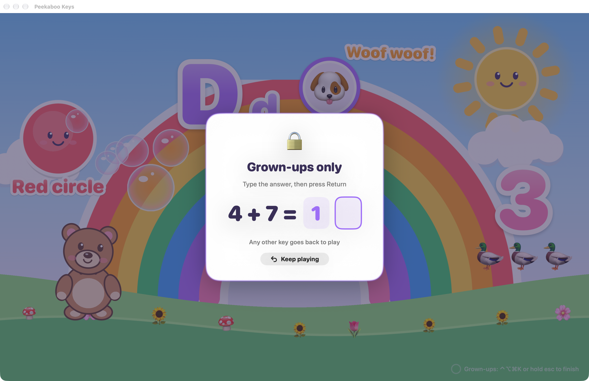

<div align="center">


# Peekaboo Keys

**Your Mac becomes a safe toddler keyboard playground in one shortcut.**

When a little one climbs up for a turn on the laptop, press **⌃⌥⌘K**. The whole screen turns into a
sunny play world with Boo the teddy. Every key the child bangs makes something happen and
teaches something: letters, picture words, counting, colours, shapes and animal sounds. Your
work stays safe underneath. Press **⌃⌥⌘K** again and you're straight back to it.



</div>

> [!NOTE]
> Made for a 1½-year-old. Health groups advise very little screen time under 2, best shared
> with a grown-up. Peekaboo Keys is built for short sessions on your lap: it names things out loud
> so you can point, repeat and laugh together, and it can end itself gently after a set time.

---

## What it does

| | |
|---|---|
| **One shortcut in, one shortcut out** | **⌃⌥⌘K** from any app starts play. Opening the app (Dock, Launchpad, Spotlight) starts play too. Press **⌃⌥⌘K** again to get back to work. |
| **Locks the screen for play** | Full screen on every display. The Dock, the menu bar, ⌘Tab, Force Quit, ⌘H and sleep are blocked. With the optional strong lock (Accessibility), every other key is caught too: ⌘Q, ⌘W, ⌘Space, media keys and trackpad swipes. |
| **Letters** | Press **B**: a big **B b**, a ⚽️ and a slow, clear voice: "B is for ball!" Each letter has several words that take turns (A is for apple, ant, airplane…). Animal words make their sound: "C is for cow! Moo!" |
| **Numbers** | Press **3**: three ducks pop in one at a time, in step with the voice: "One, two, three. Three ducks!" Ten different things to count. |
| **Every other key** | Colours and shapes ("Blue star!"). **Space** blows bubbles, **Return** makes a rainbow, **Tab** plays peekaboo with Boo, **Delete** whooshes everything away, the **arrows** make Boo hop and jump, and **Shift / ⌘ / ⌥ / ⌃** make Boo clap. |
| **Mashing is fine** | Lots of keys at once gives a confetti burst, never a mess. Things are placed so they don't cover each other or Boo, and old ones float away. |
| **Mouse and trackpad** | Tap things to hear them again, tap Boo to make him giggle, pop bubbles, drag to paint. |
| **👨‍👩‍👧 Family peekaboo** | Add photos of grandma, papa, the dog. Tab makes Boo hide, and a family face pops out with its name. You can record your own voice for each one ("Hi sweetie, it's Nani!"). |
| **Gentle ending** | Pick a play time (5–30 min, 15 by default). When it's up, night falls, Boo yawns and goes to sleep, and the voice says goodnight. |
| **Calm mode** | Fewer things at once, softer and slower, for wind-down time. |
| **Day and night** | Sunny day, starry night with fireflies, follow the Mac's appearance, or by the clock. |

<table>
<tr>
<td></td>
<td></td>
</tr>
<tr>
<td align="center">Starry night</td>
<td align="center">The grown-up sum (hold esc)</td>
</tr>
</table>

---

## Install

1. Download **PeekabooKeys.dmg** from the [latest release](https://github.com/Sravankumartangudu/peekaboo-keys/releases/latest).
2. Open it and drag **Peekaboo Keys** into **Applications**.
3. Open it. The app isn't notarised, so the first time macOS may block it: open
   **System Settings → Privacy & Security** and click **Open Anyway**.

Needs macOS 14 Sonoma or later. Runs natively on Apple silicon and Intel.

### Build from source

```
git clone https://github.com/Sravankumartangudu/peekaboo-keys.git
cd peekaboo-keys
./build.sh --install     # builds a universal app into ~/Applications and opens it
```

You only need the Xcode Command Line Tools (`xcode-select --install`). `./build.sh --dist` also
makes `build/PeekabooKeys.dmg` and `build/PeekabooKeys.zip`. Run the tests with:

```
swiftc -o /tmp/peekaboo-tests tests/main.swift Sources/Content.swift Sources/Logic.swift && /tmp/peekaboo-tests
```

`scripts/screenshots.sh` remakes the pictures above from a scripted demo (`--demo day|night|gate`)
in a normal window, with no lock and no sound.

---

## Using it

### Starting

- Press **⌃⌥⌘K** from any app, or open **Peekaboo Keys**, or pick **Start playing** in the 🧸 menu.
- While playing, the menu-bar icon shows 🎈.
- Turn on **Open at login** (⚙︎ General) so the shortcut is always ready. A login launch only waits
  in the menu bar; it never starts play by itself.

### Getting back to work

- **Quickest:** press **⌃⌥⌘K** again. Play ends at once and your windows are right where you left them.
- **Or:** hold **esc** for 3 seconds (a ring fills up in the corner), type the answer to the sum and
  press Return. The answer is always 11–18, so mashing one key and Return can't finish. Any other
  key, a wrong answer or 20 seconds of nothing goes back to play.

You can change the shortcut in ⚙︎ General (⌃⌥⌘K, ⌃⌥K, ⌃⌘K, ⌃⌥⌘P or ⌃⌥Space). Little hands
almost never hold three modifier keys and a letter at the same time.

### The strong lock

Without any permission, Peekaboo Keys blocks the Dock, the menu bar, ⌘Tab, Mission Control,
Force Quit, ⌘H and the screen going to sleep, and comes straight back if anything takes focus. For the best lock, open
🧸 → **Settings… → 🔒 Safety** and click **Allow…** to give it **Accessibility** access. Then every
key is caught while playing (⌘Q, ⌘W, ⌘Space, Siri, volume and brightness keys, trackpad
swipes) and handed to the play screen. Your shortcut still works to get back out. If the app ever
stalls, macOS releases the keyboard by itself, so it can never stay captured.

No app can block the power button or Touch ID. A keyboard cover helps with sticky fingers.

### Settings

| Tab | |
|---|---|
| 🎈 **Play** | What the keys show (everything, animals only, colours & shapes only), say the letter name or just the word, your child's name for the hello and goodbye, play time, calm mode, the sky. |
| 🔊 **Sound** | The voice on or off, which voice (Settings → Accessibility → Spoken Content can download nicer ones), how slow, music and sound effects, volume. |
| 👨‍👩‍👧 **Family** | Photos, names and your own recorded voices for peekaboo. |
| 🔒 **Safety** | The strong lock and Accessibility, what's blocked, how to finish, little tips. |
| ⚙︎ **General** | The shortcut, opening the app starts play, open at login, Appearance (System, Light or Dark). |

---

## Privacy

Peekaboo Keys has no accounts, no analytics, no ads and no network calls. Everything stays on
your Mac:

- Settings in the app's preferences (`com.stangudu.peekabookeys`).
- Family photos and recorded voices in `~/Library/Application Support/Peekaboo Keys/Family`, a
  folder only your user account can read. Delete a member and their photo and voice are deleted.
- The microphone is only used when you press **Record** on a family member, after macOS asks you.
- Speech uses the voices built into macOS.

See [SECURITY.md](SECURITY.md) for details and how to report a problem.

## Licence

MIT. See [LICENSE](LICENSE).
